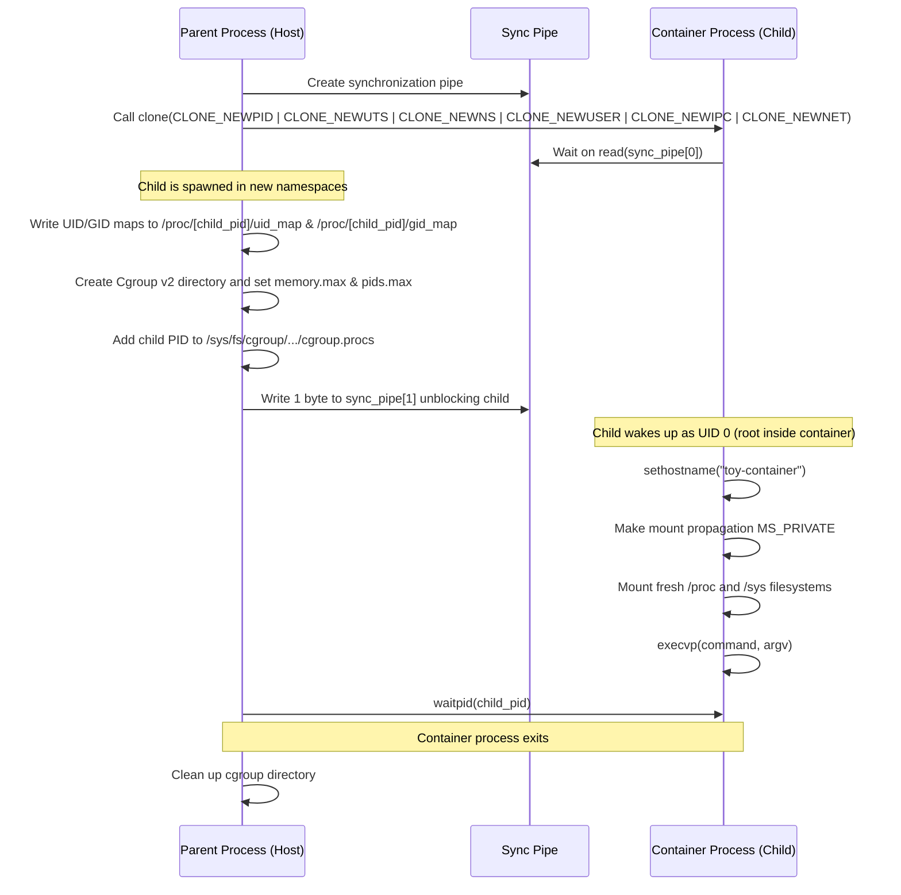

# Toy Container in C 🐳

A lightweight, educational, zero-dependency Linux container implementation written from scratch in C (C17 standard).

This project demonstrates how modern container runtimes (such as Docker, `runc`, and LXC) operate under the hood using native Linux kernel features: **Namespaces**, **Control Groups (Cgroups v2)**, **Filesystem Isolation (`pivot_root`/`chroot`)**, and **User Mappings**.

---

## 🚀 Key Features & Kernel Isolation Mechanics

| Linux Kernel Primitive | Feature | How `toy-container` Implements It |
| :--- | :--- | :--- |
| **PID Namespace** | Process ID Isolation | `CLONE_NEWPID` flag in `clone()`. Entrypoint process inside container runs as **PID 1**. |
| **UTS Namespace** | Hostname Isolation | `CLONE_NEWUTS` flag in `clone()`. Calls `sethostname()` inside container without affecting the host. |
| **Mount Namespace** | Filesystem Isolation | `CLONE_NEWNS` flag in `clone()`. Sets mount propagation to `MS_PRIVATE` and mounts fresh `/proc` & `/sys`. |
| **User Namespace** | Unprivileged Root | `CLONE_NEWUSER` flag in `clone()`. Maps host user UID/GID to container UID 0 (root) via `/proc/[pid]/uid_map` & `gid_map`. |
| **IPC Namespace** | Inter-Process Isolation | `CLONE_NEWIPC` flag in `clone()`. Isolates System V IPC and POSIX message queues. |
| **NET Namespace** | Network Stack | `CLONE_NEWNET` flag in `clone()`. Isolates network interfaces, routing tables, and firewall rules. |
| **Cgroups v2** | Resource Limits | Unified hierarchy (`/sys/fs/cgroup`). Enforces memory (`memory.max`) and process caps (`pids.max`). |

## 📚 In-Depth Documentation

For detailed technical guides explaining how each container subsystem is built in C, refer to the [`docs/`](file:///home/elvin/Development/Repositories/elvin-mark/toy-container/docs) directory:

1. 🏗️ [Architecture Overview](file:///home/elvin/Development/Repositories/elvin-mark/toy-container/docs/01-architecture-overview.md) — High-level architecture, container vs VM, process lifecycle sequence diagram, and code map.
2. 🔒 [Linux Namespaces & Process Isolation](file:///home/elvin/Development/Repositories/elvin-mark/toy-container/docs/02-namespaces.md) — `clone()` system call, stack allocation, user namespace UID/GID mapping, and synchronization pipe pattern.
3. 📁 [Filesystem & Mount Isolation](file:///home/elvin/Development/Repositories/elvin-mark/toy-container/docs/03-filesystem-and-mounts.md) — Mount propagation (`MS_PRIVATE`), procfs/sysfs mounting, `pivot_root` vs `chroot`, and Ubuntu 24.04 AppArmor userns security rules.
4. 📊 [Control Groups (Cgroups v2)](file:///home/elvin/Development/Repositories/elvin-mark/toy-container/docs/04-cgroups-v2.md) — Unified hierarchy, memory caps (`memory.max`), process caps (`pids.max`), and writable cgroup discovery algorithm.
5. 🧪 [Building, Testing & Memory Safety](file:///home/elvin/Development/Repositories/elvin-mark/toy-container/docs/05-building-and-testing.md) — Build flags (`-Wall -Wextra -Wpedantic -Werror`), AddressSanitizer (ASan/UBSan), unit & integration tests, and AppArmor setup.
6. ☸️ [OCI Runtime Mode & Kubernetes Integration](file:///home/elvin/Development/Repositories/elvin-mark/toy-container/docs/06-oci-and-kubernetes.md) — OCI `create`/`start`/`state`/`kill`/`delete` lifecycle, `config.json`, Pod `setns()`, and `containerd`/k8s scope.
7. 🔬 [Escape Hatches, Shell Equivalents & Experiments](file:///home/elvin/Development/Repositories/elvin-mark/toy-container/docs/07-escape-hatches-and-experiments.md) — Hands-on experiments, `unshare`/`nsenter` equivalents, and exercises.

> 💡 **Learning step by step?** Check out [`steps/`](file:///home/elvin/Development/Repositories/elvin-mark/toy-container/steps) for 6 self-contained mini-programs (`01-clone.c` through `06-cgroups.c`) that build up each kernel primitive one at a time.

---

## 📁 Project Structure

```
toy-container/
├── Makefile                # Build system with strict compiler flags (-Wall -Wextra -Wpedantic -Werror)
├── README.md               # Architecture documentation & usage guide
├── include/
│   └── container.h         # Header declaring configuration structures, function prototypes, & headers
└── src/
    ├── main.c              # CLI argument parser & option processing (getopt_long)
    ├── container.c         # High-level orchestration & waitpid child process lifecycle
    ├── namespaces.c        # Process cloning (clone) & UID/GID user namespace pipe synchronization
    ├── filesystem.c        # Mount propagation (MS_PRIVATE), procfs mounting, & pivot_root/chroot
    ├── cgroups.c           # Cgroup v2 directory management, memory.max, & pids.max enforcement
    ├── rootfs.c            # Helper utility for creating minimal rootfs directory trees
    └── utils.c             # Colorized logging routines & human-readable size parser (e.g., 64M -> bytes)
```

---

## 🛠️ Building the Project

### Prerequisites
- **Linux Kernel**: 4.6 or newer (requires Linux Cgroups v2 and User Namespaces enabled)
- **Compiler**: `gcc` or `clang` supporting C17 (`-std=c17`)
- **Build tool**: `make`

### Compilation Commands

```bash
# Build release binary
make

# Build with AddressSanitizer and UndefinedBehaviorSanitizer
make sanitizer

# Run test suite
make test

# Clean build artifacts
make clean
```

---

## 💡 Usage Examples

### 1. Basic Execution
Run any command inside an isolated container:

```bash
./toy-container run -- /bin/echo "Hello from inside the toy container!"
```

### 2. Verify PID Isolation
Inside the container, the process runs as **PID 1**:

```bash
./toy-container run -V -- /bin/bash -c "echo 'My Container PID is:' \$\$"
```

### 3. Verify Hostname Isolation
Set a custom hostname inside the container:

```bash
./toy-container run -V -n container-demo -- /bin/hostname
```

### 4. Apply Resource Limits (Cgroups v2)
Limit container memory to **64MB** and maximum processes to **20**:

```bash
./toy-container run -V -m 64M -p 20 -- /bin/bash
```

### 5. Environment Variables & Custom Volume Mounts
Pass custom environment variables (`-e KEY=VAL`) and bind mount host directories/files (`-v /host/path:/container/path`, requires `-r <rootfs>`):

```bash
# Download an Alpine minirootfs into ./rootfs
make rootfs

# Pass environment variables
./toy-container run -V -e APP_ENV=production -e DB_HOST=localhost -- /bin/sh -c 'echo "ENV: $APP_ENV at $DB_HOST"'

# Bind mount a host directory into a custom rootfs
sudo ./toy-container run -r ./rootfs -V -v /tmp:/data -- /bin/ls -la /data

# Combine custom rootfs, read-only bind mount, hardening, and environment variables
sudo ./toy-container run -r ./rootfs --ro --init --no-new-privs --drop-caps -v /tmp:/app/data:ro -e APP_PORT=8080 -V -- /bin/sh
```

---

## 🔬 How It Works (Step-by-Step Architecture)



---

## 📄 License
MIT License. Created for educational purposes to demonstrate Linux systems programming and container internal mechanics in C.
