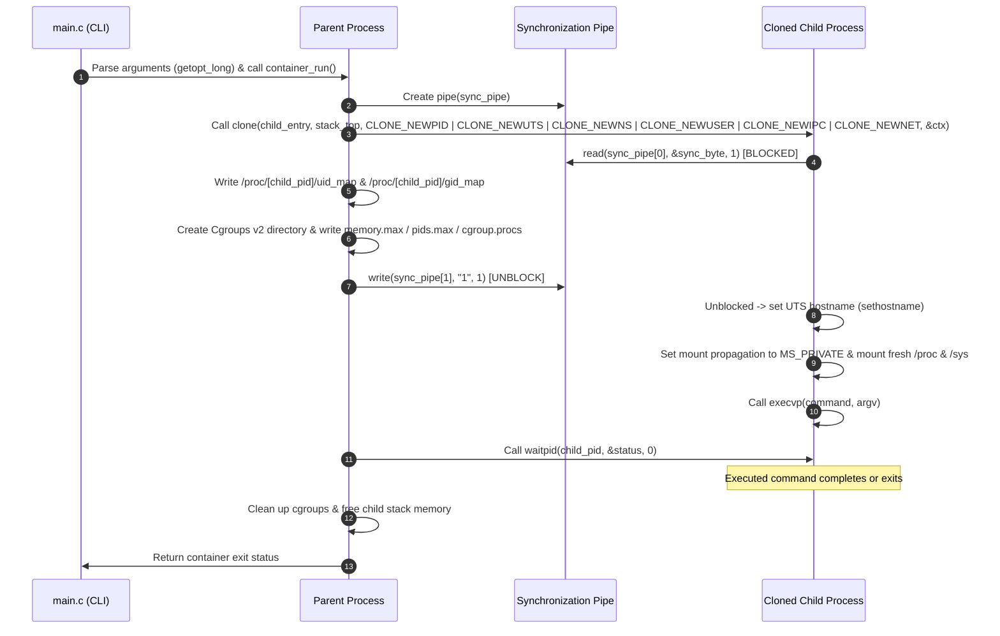

# Architecture Overview 🏗️

This document explains the software architecture, process lifecycle, and component organization of `toy-container` — a toy container runtime built from scratch in C.

---

## 1. Containers vs Virtual Machines

Unlike Virtual Machines (VMs) which emulate hardware and run an entire guest operating system (with its own kernel and virtual machine manager/hypervisor), **containers are regular host Linux processes** isolated using kernel primitives:

| Dimension | Virtual Machines (VMs) | Linux Containers |
| :--- | :--- | :--- |
| **Virtualization Level** | Hardware-level (Hypervisor, QEMU/KVM) | OS-level (Linux Kernel) |
| **Kernel** | Separate guest kernel per VM | Shared Linux host kernel |
| **Startup Time** | Seconds to minutes | Milliseconds |
| **Overhead** | High (RAM, CPU, disk per guest OS) | Minimal (native process execution speed) |
| **Isolation Boundary** | Hardware hypervisor boundary | Kernel Namespaces & Cgroups |

---

## 2. System Component Architecture

`toy-container` is structured into modular C files, each responsible for a distinct kernel subsystem:

```
                                  +-----------------------+
                                  |   CLI Entrypoint      |
                                  |     (src/main.c)      |
                                  +-----------+-----------+
                                              |
                                              v
                                  +-----------------------+
                                  |  Container Runner     |
                                  |   (src/container.c)   |
                                  +-----+-----------+-----+
                                        |           |
               +------------------------+           +------------------------+
               |                                                             |
               v                                                             v
  +--------------------------+                                 +--------------------------+
  |    Parent Process        |                                 |   Container Process      |
  |     (Host Side)          |                                 |   (Child / Namespaced)   |
  +------------+-------------+                                 +------------+-------------+
               |                                                             |
               +---> 1. Setup User ID Mappings                               +---> 1. Wait on Sync Pipe
               |       (src/namespaces.c)                                    |
               |                                                             +---> 2. Set Hostname (UTS)
               +---> 2. Setup Cgroups v2 Limits                              |
               |       (src/cgroups.c)                                       +---> 3. Setup Mounts & Proc
               |                                                             |       (src/filesystem.c)
               +---> 3. Unblock Sync Pipe                                    |
               |                                                             +---> 4. Execute Command
               +---> 4. Wait for Child (waitpid)                             |       (execvp)
```

---

## 3. Process Execution Lifecycle

The lifecycle of running a container process follows a strict 6-stage sequence:



---

## 4. File-by-File Module Map

| File Path | Functionality | Key APIs & System Calls |
| :--- | :--- | :--- |
| [`include/container.h`](file:///home/elvin/Development/Repositories/elvin-mark/toy-container/include/container.h) | Public headers, data structures (`container_opts_t`, `container_ctx_t`), constants | Header guards, system header inclusions |
| [`src/main.c`](file:///home/elvin/Development/Repositories/elvin-mark/toy-container/src/main.c) | CLI argument parsing, option validation, subcommand dispatch (`run`, `create-rootfs`, `help`) | `getopt_long()`, `strtol()`, `strdup()` |
| [`src/container.c`](file:///home/elvin/Development/Repositories/elvin-mark/toy-container/src/container.c) | High-level container orchestration, process spawning, sync pipe management, `waitpid` | `pipe()`, `kill()`, `waitpid()`, `WIFEXITED()` |
| [`src/namespaces.c`](file:///home/elvin/Development/Repositories/elvin-mark/toy-container/src/namespaces.c) | Child stack allocation, `clone()` call, User Namespace UID/GID mapping | `clone()`, `open()`, `write()`, `sethostname()` |
| [`src/filesystem.c`](file:///home/elvin/Development/Repositories/elvin-mark/toy-container/src/filesystem.c) | Mount namespace propagation (`MS_PRIVATE`), procfs/sysfs mounting, `pivot_root`/`chroot` | `mount()`, `umount2()`, `syscall(SYS_pivot_root)`, `chroot()` |
| [`src/cgroups.c`](file:///home/elvin/Development/Repositories/elvin-mark/toy-container/src/cgroups.c) | Cgroups v2 directory discovery, controller delegation, memory/PID limit setting | `mkdir()`, `access()`, `open()`, `write()` |
| [`src/rootfs.c`](file:///home/elvin/Development/Repositories/elvin-mark/toy-container/src/rootfs.c) | Helper utility for generating FHS directory structures (`/bin`, `/proc`, `/sys`, `/etc`, etc.) | `mkdir()`, `stat()` |
| [`src/utils.c`](file:///home/elvin/Development/Repositories/elvin-mark/toy-container/src/utils.c) | Terminal logging routines, size parser (`64M` -> `67108864`), options lifecycle | `vprintf()`, `strtod()`, `toupper()` |
