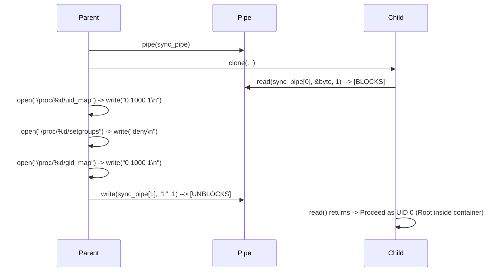

# Linux Namespaces & Process Isolation 🔒

Linux Namespaces are the core kernel feature that provides process isolation for containers. Namespaces wrap global system resources in abstractions so that processes inside a namespace see their own isolated instance of that resource.

---

## 1. The `clone()` System Call vs `fork()` / `unshare()`

In Linux, new processes can be created using `fork()`, `vfork()`, `clone()`, or `unshare()`. Containers use `clone()` because it accepts flag bitmasks specifying which namespaces to isolate for the child process.

```c
int flags = CLONE_NEWPID | CLONE_NEWUTS | CLONE_NEWNS | 
            CLONE_NEWIPC | CLONE_NEWUSER | CLONE_NEWNET | SIGCHLD;

pid_t child_pid = clone(child_entry, stack_top, flags, &ctx);
```

### Stack Allocation for `clone()`
Unlike `fork()`, which duplicates the caller's stack, `clone()` requires a manually allocated memory stack for the child process. In `toy-container`, we allocate 1MB aligned to 16 bytes:

```c
char *stack = malloc(CONTAINER_STACK_SIZE);
char *stack_top = stack + CONTAINER_STACK_SIZE;
stack_top = (char *)((uintptr_t)stack_top & ~0xF); // 16-byte alignment
```

---

## 2. Linux Namespace Types Implemented

### 1. PID Namespace (`CLONE_NEWPID`)
- **What it does**: Isolates the process ID space.
- **Inside Container**: The first process spawned (`child_entry`) becomes **PID 1** inside its own PID namespace.
- **Host View**: The host kernel assigns a standard host PID (e.g. PID `12018`) to the same process.
- **Why PID 1 is special**: In Linux, PID 1 is the `init` process. If PID 1 terminates, all child processes inside that PID namespace are terminated by the kernel.

### 2. User Namespace (`CLONE_NEWUSER`)
- **What it does**: Isolates User IDs (UID) and Group IDs (GID).
- **Unprivileged Root**: Allows an unprivileged user (host UID 1000) to map host UID 1000 to UID 0 (root) *inside* the container.
- **Security Boundary**: The process has root capabilities (`CAP_SYS_ADMIN`, `CAP_NET_ADMIN`, etc.) inside the container, but remains a standard unprivileged user on the host system.

### 3. UTS Namespace (`CLONE_NEWUTS`)
- **What it does**: Isolates Hostname and NIS Domain name (`UNIX Timesharing System`).
- **Implementation**: Calling `sethostname("toy-container", 13)` changes the hostname only for processes inside the container UTS namespace, leaving the host system hostname untouched.

### 4. Mount Namespace (`CLONE_NEWNS`)
- **What it does**: Isolates mount points and filesystem views.
- **Implementation**: The container can mount or unmount filesystems (`/proc`, `/sys`, `/tmp`, `pivot_root`) without altering the host filesystem mount table.

### 5. IPC Namespace (`CLONE_NEWIPC`)
- **What it does**: Isolates Inter-Process Communication (IPC) resources: System V IPC objects and POSIX message queues.
- **Benefit**: Container processes cannot access host shared memory segments (`shmget`) or semaphores.

### 6. Network Namespace (`CLONE_NEWNET`)
- **What it does**: Isolates network interfaces, IP addresses, routing tables, and socket lists.
- **Benefit**: The container gets its own isolated loopback interface (`lo`) and network stack.

---

## 3. User Namespace UID / GID Mapping & Synchronization

When a process creates a new User Namespace (`CLONE_NEWUSER`), its UID and GID initially default to `65534` (`nobody`).

To grant root permissions (UID 0) inside the container, the **parent process** must write ID mappings into `/proc/[child_pid]/uid_map` and `/proc/[child_pid]/gid_map`.

### UID Mapping Format
```text
<container_uid> <host_uid> <count>
0               1000       1
```
This line instructs the kernel to map container UID `0` to host UID `1000` for `1` consecutive ID.

### Synchronization Pipe Pattern

Because the child process cannot perform root operations until the parent writes the UID/GID mapping, a `pipe()` is used to synchronize the two processes:



### Source Code Implementation (`src/namespaces.c`)

```c
int setup_id_mappings(pid_t child_pid) {
    uid_t uid = getuid();
    gid_t gid = getgid();
    char path[256], map_buf[64];

    /* Write UID map */
    snprintf(path, sizeof(path), "/proc/%d/uid_map", child_pid);
    int fd = open(path, O_WRONLY);
    int len = snprintf(map_buf, sizeof(map_buf), "0 %d 1\n", uid);
    write(fd, map_buf, len);
    close(fd);

    /* Disable setgroups (required for unprivileged GID mapping) */
    snprintf(path, sizeof(path), "/proc/%d/setgroups", child_pid);
    fd = open(path, O_WRONLY);
    write(fd, "deny\n", 5);
    close(fd);

    /* Write GID map */
    snprintf(path, sizeof(path), "/proc/%d/gid_map", child_pid);
    fd = open(path, O_WRONLY);
    len = snprintf(map_buf, sizeof(map_buf), "0 %d 1\n", gid);
    write(fd, map_buf, len);
    close(fd);

    return 0;
}
```
