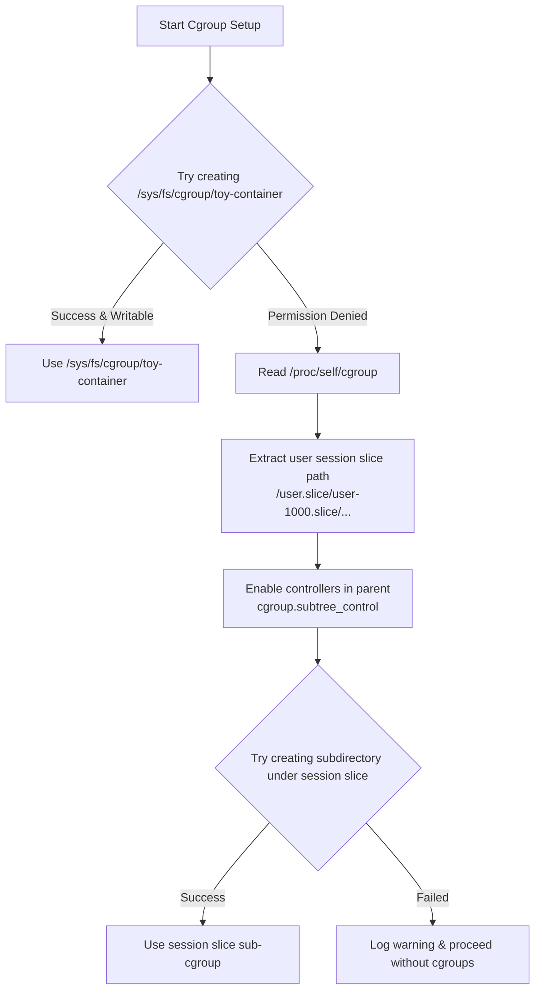

# Control Groups (Cgroups v2) & Resource Controls 📊

Control Groups (cgroups) are a Linux kernel feature that limits, accounts for, and isolates resource usage (CPU, memory, disk I/O, PIDs) for a collection of processes.

---

## 1. Cgroups v1 vs Cgroups v2

Modern Linux distributions (Ubuntu 22.04+, Fedora, Debian 11+, RHEL 9+) default to **Cgroups v2** (unified hierarchy).

| Feature | Cgroups v1 | Cgroups v2 (Implemented) |
| :--- | :--- | :--- |
| **Hierarchy** | Multiple distinct trees per controller (`/sys/fs/cgroup/memory`, `/sys/fs/cgroup/pids`) | Single unified tree (`/sys/fs/cgroup/...`) |
| **Process Assignment** | Processes can belong to different groups in different controllers | A process belongs to exactly one cgroup in the unified tree |
| **Control File Format** | `memory.limit_in_bytes`, `pids.max` | `memory.max`, `pids.max` |
| **Delegation** | Fragile per-controller delegation | Clear rootless/user delegation via `cgroup.subtree_control` |

---

## 2. Cgroup v2 Directory Structure

In Cgroups v2, directories under `/sys/fs/cgroup/` represent control groups:

```
/sys/fs/cgroup/
├── cgroup.procs
├── cgroup.subtree_control   (contains: +memory +pids)
└── toy-container/
    ├── cgroup.procs         (contains: 12018)
    ├── memory.max           (contains: 67108864)
    └── pids.max             (contains: 20)
```

---

## 3. Resource Control Interface in `src/cgroups.c`

`toy-container` implements three main control operations:

### 1. Memory Limit (`memory.max`)
Limits total RAM usage for the container (including child processes). When memory exceeds `memory.max`, the Linux Out-Of-Memory (OOM) killer terminates processes inside the cgroup:

```c
// Limit memory to 64MB (67108864 bytes)
write_cgroup_file(cgroup_dir, "memory.max", "67108864\n");
```

### 2. PID Count Limit (`pids.max`)
Limits the maximum number of processes that can be created (via `fork`, `clone`) inside the container. This prevents **fork bomb** attacks from crashing the host:

```c
// Limit max processes to 20
write_cgroup_file(cgroup_dir, "pids.max", "20\n");
```

### 3. Process Attachment (`cgroup.procs`)
Attaches the container process (and all future child processes created by it) to the control group:

```c
// Write child PID to cgroup.procs
write_cgroup_file(cgroup_dir, "cgroup.procs", "12018\n");
```

---

## 4. Writable Cgroup Auto-Discovery Algorithm

When running as a normal user or under systemd session slices, writing directly to `/sys/fs/cgroup/toy-container` might fail if permissions are restricted.

`toy-container` implements a 2-step fallback discovery algorithm:



### Automatic Cleanup
When the container process exits, `container_run()` cleans up the temporary cgroup directory:

```c
void cleanup_cgroups(const char *cgroup_path) {
    if (!cgroup_path || strlen(cgroup_path) == 0) return;
    rmdir(cgroup_path);
}
```
