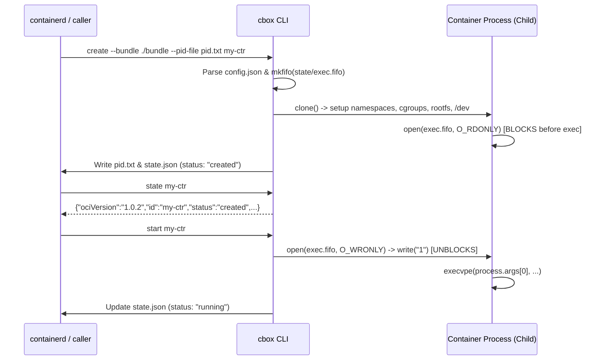

# OCI Runtime Mode & Kubernetes Integration ☸️

This document explains how Kubernetes runs containers under the hood, how `cbox` implements the **OCI (Open Container Initiative) Runtime Specification** (`runc`-compatible CLI + `config.json`), and what is supported vs. out of scope for production Kubernetes clusters.

---

## 1. How Kubernetes Invokes a Container Runtime

Kubernetes (`kubelet`) does **not** run containers directly. It delegates through two layers:

```
kubelet  ──(CRI over gRPC)──▶  containerd / CRI-O  ──(OCI CLI + config.json)──▶  runc / crun / cbox
```

1. **CRI (Container Runtime Interface)**: `kubelet` sends gRPC calls (`RunPodSandbox`, `CreateContainer`, `StartContainer`) to `containerd`.
2. **OCI Low-Level Runtime**: `containerd` prepares an OCI bundle (`config.json` + `rootfs/`) and invokes a low-level runtime binary (`runc` by default) using five lifecycle commands:
   - `create --bundle <dir> --pid-file <path> <id>`
   - `start <id>`
   - `state <id>`
   - `kill <id> [signal]`
   - `delete [--force] <id>`

---

## 2. How `cbox` Implements the OCI Lifecycle

### The `create` / `start` FIFO Handshake
In Kubernetes/CRI, creating a container and starting it are two separate steps so `containerd` can attach logging/networking hooks before the workload runs:



### Kubernetes Pod Namespace Sharing (`setns()`)
In a Kubernetes Pod, multiple containers share a single IP address and `localhost` network stack. `containerd` achieves this by:
1. Starting a `pause` sandbox container first.
2. Passing `"path": "/proc/<pause_pid>/ns/net"` (and `ipc`, `uts`) inside `"linux.namespaces"` of `config.json` for app containers.

`cbox` checks each namespace entry in `config.json`:
- If `path` is omitted, it passes `CLONE_NEW*` to `clone()`.
- If `path` is present, it omits `CLONE_NEW*` and calls `setns(open(path), CLONE_NEW*)` inside the child process!

---

## 3. Trying OCI Mode Locally

```bash
# 1. Prepare a bundle directory with an Alpine rootfs
make rootfs
mkdir -p /tmp/oci-bundle
ln -s "$(pwd)/rootfs" /tmp/oci-bundle/rootfs

# 2. Write a minimal OCI config.json
cat > /tmp/oci-bundle/config.json <<'EOF'
{
  "ociVersion": "1.0.2",
  "hostname": "k8s-demo-pod",
  "root": {"path": "rootfs", "readonly": false},
  "process": {
    "args": ["/bin/sleep", "30"],
    "env": ["PATH=/bin:/usr/sbin:/usr/bin:/sbin:/bin"],
    "cwd": "/",
    "noNewPrivileges": true
  },
  "linux": {
    "namespaces": [
      {"type": "pid"},
      {"type": "ipc"},
      {"type": "uts"},
      {"type": "mount"},
      {"type": "user"}
    ],
    "resources": {
      "memory": {"limit": 67108864},
      "pids": {"limit": 32}
    }
  }
}
EOF

# 3. Run the full OCI lifecycle
./cbox create --bundle /tmp/oci-bundle --pid-file /tmp/ctr.pid demo-pod
./cbox state demo-pod
./cbox start demo-pod
./cbox state demo-pod
./cbox exec demo-pod -- /bin/sh -c 'echo "Hello from inside running pod, PID=$$"'
./cbox kill demo-pod SIGKILL
./cbox delete demo-pod
```

To use `cbox` as a `containerd` runtime handler (for `k3s` / `kubeadm`), register a `RuntimeClass` pointing `containerd`'s `runc` shim `BinaryName` to `/usr/local/bin/cbox`.

---

## 4. Current Scope & Honest Limitations for Production k8s

`cbox` implements the core OCI lifecycle (`create`, `start`, `state`, `exec`, `kill`, `delete`, `run`), `config.json` and `process.json` parsing (`src/json.c`, `src/oci.c`), `setns()` namespace joining, `/dev` node setup, `lo` loopback bring-up, `noNewPrivileges`, and cgroup v2 `memory.max`/`pids.max`/`cpu.max`.

For full production Kubernetes conformance (`containerd` CRI integration tests), the following OCI features are **not yet implemented**:
- `--console-socket` PTY file descriptor passing via `SCM_RIGHTS`
- Seccomp BPF filter compilation from `linux.seccomp` in `config.json`
- `systemd` D-Bus cgroup driver (`--systemd-cgroup` is accepted as a CLI flag, but cgroups are written directly to `/sys/fs/cgroup`)
- Full OCI `linux.capabilities` bounding/effective/permitted sets (currently uses `--drop-caps` fixed list)
